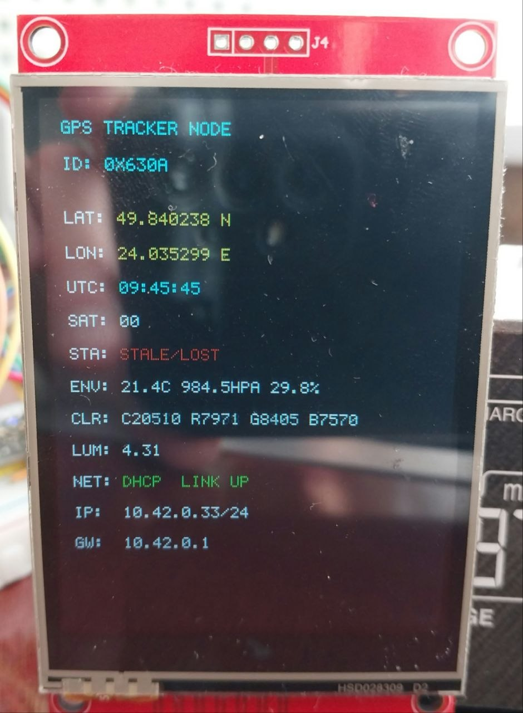
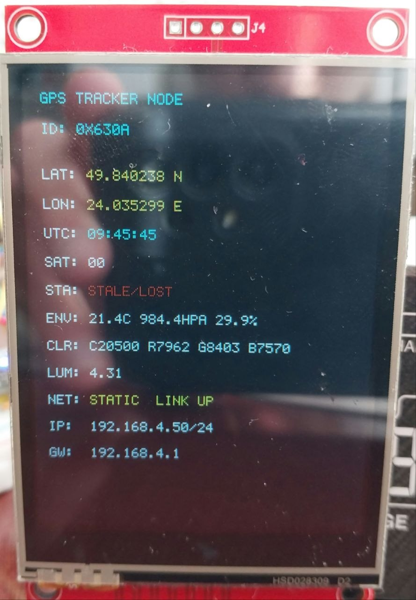
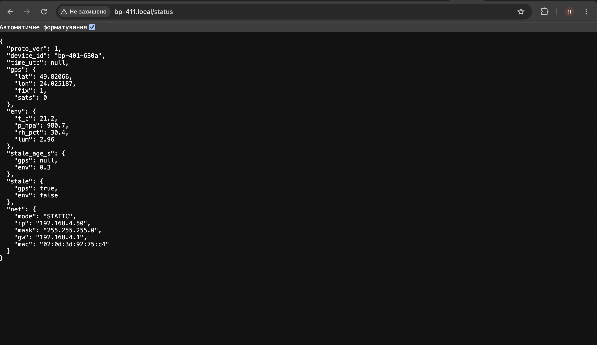
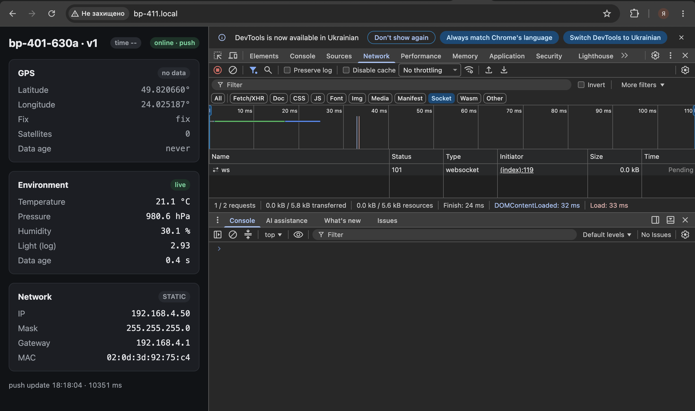

# Lab 5 - Network device panel over Ethernet (W5500)

STM32F401 ("Black Pill") firmware that reads GPS (UART), a BME280 (temperature / pressure / humidity) and a TCS3472 colour sensor (I2C), shows them on an ILI9341 SPI-TFT and serves the same data over Ethernet through a WIZnet W5500: `GET /status` returns JSON, `GET /` returns a web page that refreshes once per second. The network comes up with DHCP and falls back to a static address when no DHCP server answers.

**Demo video (36 s):** [assets/demo-board-and-page-1hz.mp4](assets/demo-board-and-page-1hz.mp4). It shows the wiring, the display with the network rows, and the page refreshing once per second.

**Contributors:**
- **Bohdan Zasymovych**
- **Yaryna Zabchuk**


## Project structure

```text
Lab_Ethernet/
├── Lab_Ethernet.ioc                    CubeMX project
├── Core/
│   ├── Inc/utils/                      headers of this project's own modules
│   │   ├── w5500_port.h                W5500 glue: SPI2, CS, reset, ioLibrary callbacks
│   │   ├── net.h                       MAC, link, DHCP with static fallback
│   │   ├── status.h                    status snapshot + /status JSON and CBOR
│   │   ├── http_server.h               HTTP server on port 80, WebSocket /ws
│   │   ├── mdns.h                      mDNS responder (bp-411.local)
│   │   ├── web_page.h                  the page served at /
│   │   ├── bme280.h                    BME280 driver: forced mode, compensation, stale
│   │   ├── tcs3472.h                   TCS3472 driver: init, C/R/G/B read, stale
│   │   ├── ui.h                        dirty-row layout (GPS, sensor and network rows)
│   │   ├── ili9341.h                   display driver (SPI + DMA)
│   │   ├── gps_parser.h                NMEA parsing + line queue
│   │   ├── gps_flash.h                 last-fix flash cache
│   │   └── cli.h                       USB-CDC command line
│   └── Src/                            main.c, interrupt handlers, utils/*.c
├── Middlewares/Third_Party/WIZnet/     WIZnet ioLibrary_Driver (commit e179197): socket API, W5500 driver, DHCP client
└── USB_DEVICE/                         CubeMX USB-CDC (VCP) stack

assets/                                 screenshots, photos and videos used in this README
host-setup/                             udev rule for a stable /dev path
```


## Pin map

| Signal | Pin |
|---|---|
| I2C2: SCL / SDA | PB10, PB3 |
| SPI1: SCK / MOSI | PA5 / PA7 |
| LCD_CS / DC / RESET | PB6 / PB7 / PB8 |
| LCD_LED | 3.3V |
| SPI2: SCK / MISO / MOSI | PB13 / PB14 / PB15 |
| W5500_CS | PB12 |
| W5500_RST | PB1 |
| W5500 power | 5V (VBUS) |
| USART1: TX / RX | PA9 / PA10 |
| USB (CLI) | PA11 / PA12, OTG FS, CDC ACM |
| Status LED | PC13 |

## Buses and rates

| Bus | Setting |
|---|---|
| I2C2 | 100 kHz, standard mode, 7-bit addressing |
| SPI1 | Mode 0, 8-bit, MSB first, 10.5 MHz SCK (84 MHz / 8), TX by DMA |
| SPI2 | Mode 0, 8-bit, MSB first, full duplex, 10.5 MHz SCK (APB1 42 MHz / 4), blocking transfers |
| USART1 | 9600 8N1, RX by DMA with IDLE-line detection |

| I2C device | 7-bit address |
|---|---|
| BME280 | `0x76` |
| TCS3472 | `0x29` |

| Activity | Period |
|---|---|
| Sensor read (both) | 1 s |
| Display refresh (changed rows only) | 1 s |
| Stale check, status snapshot, network and HTTP processing | every main-loop pass (~50 ms) |


## Ethernet

### Transport

The W5500 module is used. It has the MAC, PHY and a hardware TCP/IP stack (TCP, UDP, IPv4, ARP, ICMP), 8 sockets and 32 KB of buffers. The MCU only reads and writes registers and socket buffers over SPI. Ping and ARP are answered by the chip itself.

Software layers:

| Layer | File | Job |
|---|---|---|
| WIZnet ioLibrary | `Middlewares/Third_Party/WIZnet` | BSD-like socket API, W5500 registers, DHCP client |
| Port | `w5500_port.c` | SPI2 byte/burst callbacks, CS, hardware reset, `VERSIONR == 0x04` check |
| Network | `net.c` | MAC, link, DHCP → static fallback state machine |
| Data | `status.c` | one snapshot of GPS + sensors, JSON and CBOR formatting |
| HTTP | `http_server.c` | socket state machines on port 80, routing, WebSocket |
| mDNS | `mdns.c` | answers `bp-411.local` on UDP 5353 |
| Page | `web_page.c` | HTML/JS served at `/` |

Everything runs from the main loop and never blocks on the network. Sensors are read in the loop, and the HTTP server only formats the last snapshot, so a request never touches I2C or UART.

### Network configuration

- **MAC:** `02:xx:xx:xx:xx:xx`, from an FNV-1a hash of the 96-bit chip UID. `0x02` marks it locally administered and unicast. It is unique per board and the same after every reboot.
- **DHCP first:** started when the PHY link comes up. The ioLibrary client runs on socket 7.
- **Static fallback:** if there is no lease within **10 s**, the firmware uses `192.168.4.50/24` and gateway `192.168.4.1` (`NET_STATIC_*` in `net.h`).
- **Link loss:** the IP is cleared, and the DHCP → static cycle runs again on re-plug. A failed lease renewal restarts the same cycle.
- **Socket buffers:** 2 KB TX and 2 KB RX per socket. HTTP uses sockets 0–3, mDNS socket 6, DHCP socket 7.
- **Shown on** the display (`NET` / `IP` / `GW` rows), in the `NET` CLI command and in the `net` object of `/status`.

| State (display `NET:` row) | Meaning |
|---|---|
| `W5500 NOT FOUND` (red) | `VERSIONR` was not `0x04`: wiring, power or SPI problem |
| `NO LINK` (red) | no cable / no PHY link |
| `DHCP...` (cyan) | waiting for a lease, at most 10 s |
| `DHCP  LINK UP` (green) | address from DHCP |
| `STATIC  LINK UP` (yellow) | static fallback |

### HTTP server

HTTP/1.1 on port 80. One request per connection (`Connection: close`), except `/ws`, which keeps its socket open. Only the request line is parsed; headers are read and dropped.

| Request | Response |
|---|---|
| `GET /` | `200`, `text/html`, the web page |
| `GET /status` (query string ignored) | `200`, `application/json`, `Access-Control-Allow-Origin: *` |
| `GET /status.cbor` | `200`, `application/cbor` (see [CBOR](#cbor-status-endpoint)) |
| `GET /ws` | `101 Switching Protocols`, status JSON pushed every second (see [WebSocket](#websocket-status-updates)) |
| other path | `404` |
| other method | `405`, `Allow: GET` |
| unparseable request line | `400` |

Every response carries `Content-Length` and `Cache-Control: no-store`. A small response (headers + JSON) goes out in one `send()`, so in one TCP segment. Each of the 4 sockets runs its own state machine (`CLOSED → INIT → LISTEN → ESTABLISHED → closing`). A client that connects and sends nothing is dropped after 2 s, and a socket stuck while closing is force-closed after 2 s. `disconnect()` runs in non-blocking mode so the main loop never waits for the peer.

### `/status` JSON

```json
{"proto_ver":1,"device_id":"bp-401-630a","time_utc":"2026-11-15T09:48:23Z",
 "gps":{"lat":49.840238,"lon":24.035300,"fix":1,"sats":0},
 "env":{"t_c":21.5,"p_hpa":984.6,"rh_pct":29.7,"lum":4.36},
 "stale_age_s":{"gps":153.4,"env":0.3},
 "stale":{"gps":true,"env":false},
 "net":{"mode":"DHCP","ip":"10.42.0.33","mask":"255.255.255.0","gw":"10.42.0.1","mac":"02:0d:3d:92:75:c4"}}
```

| Field | Meaning |
|---|---|
| `proto_ver` | schema version, raised when the schema changes |
| `device_id` | `bp-401-` + the 16-bit UID-derived id shown on the display |
| `time_utc` | ISO 8601 from the GPS RMC date and time; `null` if unknown |
| `gps.lat`, `gps.lon` | degrees, 6 decimals, negative = S / W; `null` before the first fix |
| `gps.fix` | `0` = no fix, `1` = fix (RMC status; the parser does not read GSA, so there is no 2D/3D) |
| `gps.sats` | satellites in use (GGA) |
| `env.t_c`, `env.p_hpa`, `env.rh_pct` | BME280, 1 decimal |
| `env.lum` | TCS3472 light level `log10(clear + 1)`, unit-less, **not lux** (see [TCS3472](#tcs3472)) |
| `stale_age_s.gps`, `stale_age_s.env` | seconds since the last valid reading (`env`: the older of the two sensors); `null` if never |
| `stale.gps`, `stale.env` | `true` if the age is over 3 s or there was never any data |
| `net` | current mode, IP, mask, gateway, MAC |

Values that never arrived are `null`, never `0`. Numbers are printed with integer math, so the output does not depend on `printf` float support. The body is about 330 bytes, and the formatting buffer holds 512.

### Web page

One self-contained HTML file (CSS and JS inline, about 5.6 KB in flash), with no framework and no CDN, because the board is often on a direct link without internet.

- Receives the status JSON once per second over a WebSocket (`/ws`) and reconnects 1 s after the connection drops.
- The DOM is built once. An update only changes the `textContent`/`className` of values that changed, so nothing flickers.
- GPS and Environment cards show a `live` / `stale N s` / `no data` badge and the data age. Stale values are dimmed.
- If the connection drops, a `reconnecting` badge appears, the last values stay, and their age keeps growing.
- A Network card shows the mode, IP, mask, gateway and MAC.

The 1 Hz refresh is shown in the [demo video](assets/demo-board-and-page-1hz.mp4) (from about 0:16). It was recorded with the first version of the page, which polled `/status` and displayed the raw JSON. The current page is in the [WebSocket screenshot](#websocket-status-updates).

### Host connection setup

Static mode: give the PC's port the board's gateway address, `192.168.4.1/24`, with no DHCP server running:
```bash
sudo ip addr add 192.168.4.1/24 dev eno1
```

DHCP mode: run a DHCP server on the port (NetworkManager "shared" mode, the PC becomes `10.42.0.1/24`):
```bash
nmcli connection add type ethernet ifname eno1 con-name stm32-webserver-dhcp ipv4.method shared ipv6.method disabled
nmcli connection up stm32-webserver-dhcp
```

The board asks for an address only when the link comes up, so reset it or re-plug after switching modes.


## Sensors

### BME280

- Init: chip ID must be `0x60`, then the calibration blocks are read, then the sensor is configured. Every step is checked, and a failed init is retried once per second.
- **Forced mode**: oversampling x1 for T/P/RH, IIR filter coefficient 4. The sensor sleeps between readings.
- One reading per second: trigger a measurement, wait 10 ms, poll the status register until `measuring` clears, then read 8 data bytes. Values are compensated with the Bosch reference integer routines.

### TCS3472

- Init: power on (`PON`), wait 3 ms, enable the ADC (`PON | AEN`). Retried once per second if it fails.
- One reading per second: command byte (command bit + auto-increment + register `0x14`), then 8 bytes: clear, red, green, blue (16-bit, little-endian). Integration time and gain are left at the sensor defaults.
- `LUM` is **not lux**: it is a unit-less log-scale light level, `log10(clear + 1)`, used instead of a lux sensor for a smoother display in dark and bright light. The same value is sent as `env.lum` in `/status`.

### Stale data

Each sensor stores the time of its last successful read. A read that fails changes nothing, so the last valid value stays. Every main-loop pass sets `is_stale` when the data is older than **3 s** (or was never read), and a successful read clears it immediately.


## Display

```text
ID: 0x<UID-derived 16-bit id>
LAT: <±dd.dddddd N/S>
LON: <±ddd.dddddd E/W>
UTC: <hh:mm:ss>
SAT: <count>
STA: WAITING FIX / ACTIVE FIX / STALE/LOST
ENV: 22.5C 991.0hPa 42.0%
CLR: C562 R275 G237 B212
LUM: 2.75
NET: DHCP  LINK UP
IP:  10.42.0.33/24
GW:  10.42.0.1
```

- `ui.c` remembers the text and colour of every data row, pads it to a fixed width, and redraws a row only when it changed, so nothing flickers. `UI_Redraw()` repaints everything (boot, orientation change).
- Stale sensor rows turn **red** and get an age marker: ` !12s` means 12 s since the last valid reading (capped at 99), ` !--` means the sensor never delivered a value. A sensor that failed to initialise shows `… INIT FAILED` in red.
- The network rows only read the cached state from `net.c` (colours in [Network configuration](#network-configuration)). `IP`/`GW` show `--` while the network is down. In landscape (240 px high) only the `NET:` row fits.
- Text is a 5×7 font in 6×8 cells, drawn with one SPI DMA burst per row.
- The "address" is the 96-bit chip unique ID (`0x1FFF7A10`) XOR-folded to 16 bits.




## CLI

USB CDC, one command per line, replies are prefixed `[CLI]`.

| Command | Response |
|---|---|
| `VER` | firmware version, build date/time, UART/USB parameters |
| `GET POS` / `GET TIME` | position (`LAT,LON,FIX,SATS,AGE_MS`) / ISO time with `STALE` |
| `GET BME` (`GET ENV`) | `TEMP, PRESS, HUM, STALE, AGE_MS` |
| `GET COLOR` (`GET TCS`) | `CLEAR, RED, GREEN, BLUE, STALE, AGE_MS` |
| `NET` | `STATE, MODE, LINK, IP, MASK, GW, MAC, LEASE_S, NET_UP_S, HTTP_UP_S, HTTP_REQ` |
| `RAW ON` / `RAW OFF` | raw NMEA relay (`[LOG]`-tagged) |
| `GET ERRORS` | UART error counters, RX bytes, dropped GPS lines |
| `FLASH SAVE` / `FLASH INFO` | last-fix flash cache |
| `TEST COLORS` / `ORIENT` | full-screen colour test / portrait-landscape toggle |
| `DISP INFO` | last tile's SCK, byte count and DMA time |

The sensor commands and `NET` only set a request flag in the USB interrupt; the main loop builds the reply so it never reads half-updated data. `NET` uses the cached link state and does not access the W5500 over SPI.

```text
[CLI] STATE:UP, MODE:DHCP, LINK:UP, IP:10.42.0.33, MASK:255.255.255.0, GW:10.42.0.1, MAC:02:0d:3d:92:75:c4, LEASE_S:3600, NET_UP_S:32, HTTP_UP_S:32, HTTP_REQ:31
```


## Interrupts and priorities

| Interrupt | Priority |
|---|---|
| USART1 (GPS, IDLE line) | 0 (highest) |
| DMA2 Stream2 (GPS UART RX) | 1 |
| DMA2 Stream3 (SPI1 TX) | 2 |

I2C and SPI2 (W5500) use polling, so they add no interrupt that could delay GPS reception. The BME280 read blocks the main loop for about 10 ms once per second.


## Measurements

| Item | Value |
|---|---|
| Tile update, one data row (24 chars × 6×8 px = 144×8 px, 2304 B, SCK 10.5 MHz), measured in the previous lab | ~1.77 ms |
| Polling periods | 1 s (sensors), 1 s (UI), stale check every ~50 ms |
| `/status` processing in firmware (request read → response sent), from the tcpdump below | 1.2–1.9 ms |
| `/status` TTFB on a direct link, 13 requests | median 33 ms, min 17 ms, max 310 ms |


## Network experiments

All on a direct cable between the board and the laptop's `eno1` (setup in [Host connection setup](#host-connection-setup)).

### 1. DHCP mode: reachability, ARP, `/status`

The PC runs NetworkManager's DHCP server (`10.42.0.1/24`). The board got `10.42.0.33`.

```text
❯ ping -c 3 10.42.0.33
64 bytes from 10.42.0.33: icmp_seq=1 ttl=128 time=0.188 ms
64 bytes from 10.42.0.33: icmp_seq=2 ttl=128 time=0.115 ms
64 bytes from 10.42.0.33: icmp_seq=3 ttl=128 time=0.122 ms
3 packets transmitted, 3 received, 0% packet loss, time 2072ms
rtt min/avg/max/mdev = 0.115/0.141/0.188/0.032 ms

❯ arp -a 10.42.0.33
? (10.42.0.33) at 02:0d:3d:92:75:c4 [ether] on eno1

❯ curl http://10.42.0.33/status
{"proto_ver":1,"device_id":"bp-401-630a","time_utc":"2007-04-01T09:48:23Z","gps":{"lat":49.840238,"lon":24.035300,"fix":1,"sats":0},"env":{"t_c":21.5,"p_hpa":984.6,"rh_pct":29.7,"lum":4.36},"stale_age_s":{"gps":153.4,"env":0.3},"stale":{"gps":true,"env":false},"net":{"mode":"DHCP","ip":"10.42.0.33","mask":"255.255.255.0","gw":"10.42.0.1","mac":"02:0d:3d:92:75:c4"}}
```

- Ping answers in 0.1–0.2 ms with no loss. ICMP is handled by the W5500 hardware, without firmware code.
- The ARP entry has the UID-derived MAC `02:0d:3d:92:75:c4`, the same as in the JSON and in `NET`. The DHCP lease is 3600 s.
- In the JSON, `env` is fresh (0.3 s) and GPS is stale. The test ran indoors with no satellites (`sats: 0`), so the position is the last fix, 153 s old, and `stale.gps` is `true` as intended.

The board's reply to the `NET` command sent over the USB CLI:
```text
[CLI] STATE:UP, MODE:DHCP, LINK:UP, IP:10.42.0.33, MASK:255.255.255.0, GW:10.42.0.1, MAC:02:0d:3d:92:75:c4, LEASE_S:3600, NET_UP_S:32, HTTP_UP_S:32, HTTP_REQ:31
```

It was captured in DHCP mode: the address and mask match the ones above (`10.42.0.33/24`), the gateway is the PC's port address, and the MAC is the generated one.

### 2. TCP traffic of the page polling `/status` (tcpdump)

Traffic on `eno1` while the page was open: 13 requests in 13 s, one TCP connection per request.

```text
❯ sudo tcpdump -i eno1
tcpdump: verbose output suppressed, use -v[v]... for full protocol decode
listening on eno1, link-type EN10MB (Ethernet), snapshot length 262144 bytes
11:50:33.806933 IP bohdan-laptop-ubuntu.45664 > 10.42.0.33.http: Flags [S], seq 3869501421, win 64240, options [mss 1460,sackOK,TS val 1658418224 ecr 0,nop,wscale 10], length 0
11:50:33.806990 IP 10.42.0.33.http > bohdan-laptop-ubuntu.45664: Flags [S.], seq 3768280991, ack 3869501422, win 2048, options [mss 1460], length 0
11:50:33.807068 IP bohdan-laptop-ubuntu.45664 > 10.42.0.33.http: Flags [.], ack 1, win 64240, length 0
11:50:33.807281 IP bohdan-laptop-ubuntu.45664 > 10.42.0.33.http: Flags [P.], seq 1:324, ack 1, win 64240, length 323: HTTP: GET /status HTTP/1.1
11:50:33.807373 IP 10.42.0.33.http > bohdan-laptop-ubuntu.45664: Flags [.], ack 324, win 1725, length 0
11:50:33.843072 IP 10.42.0.33.http > bohdan-laptop-ubuntu.45664: Flags [.], ack 324, win 2048, length 0
11:50:33.844924 IP 10.42.0.33.http > bohdan-laptop-ubuntu.45664: Flags [P.], seq 1:516, ack 324, win 2048, length 515: HTTP: HTTP/1.1 200 OK
11:50:33.844924 IP 10.42.0.33.http > bohdan-laptop-ubuntu.45664: Flags [F.], seq 516, ack 324, win 2048, length 0
11:50:33.845026 IP bohdan-laptop-ubuntu.45664 > 10.42.0.33.http: Flags [.], ack 516, win 63784, length 0
11:50:33.845464 IP bohdan-laptop-ubuntu.45664 > 10.42.0.33.http: Flags [F.], seq 324, ack 517, win 63784, length 0
11:50:33.845510 IP 10.42.0.33.http > bohdan-laptop-ubuntu.45664: Flags [.], ack 325, win 2048, length 0
11:50:34.850679 IP bohdan-laptop-ubuntu.43518 > 10.42.0.33.http: Flags [S], seq 2010306374, win 64240, options [mss 1460,sackOK,TS val 1937468100 ecr 0,nop,wscale 10], length 0
11:50:34.850736 IP 10.42.0.33.http > bohdan-laptop-ubuntu.43518: Flags [S.], seq 3794376596, ack 2010306375, win 2048, options [mss 1460], length 0
11:50:34.850796 IP bohdan-laptop-ubuntu.43518 > 10.42.0.33.http: Flags [.], ack 1, win 64240, length 0
11:50:34.850978 IP bohdan-laptop-ubuntu.43518 > 10.42.0.33.http: Flags [P.], seq 1:324, ack 1, win 64240, length 323: HTTP: GET /status HTTP/1.1
11:50:34.851057 IP 10.42.0.33.http > bohdan-laptop-ubuntu.43518: Flags [.], ack 324, win 1725, length 0
11:50:34.881974 IP 10.42.0.33.http > bohdan-laptop-ubuntu.43518: Flags [.], ack 324, win 2048, length 0
11:50:34.883582 IP 10.42.0.33.http > bohdan-laptop-ubuntu.43518: Flags [P.], seq 1:516, ack 324, win 2048, length 515: HTTP: HTTP/1.1 200 OK
11:50:34.883582 IP 10.42.0.33.http > bohdan-laptop-ubuntu.43518: Flags [F.], seq 516, ack 324, win 2048, length 0
11:50:34.883649 IP bohdan-laptop-ubuntu.43518 > 10.42.0.33.http: Flags [.], ack 516, win 63784, length 0
11:50:34.884004 IP bohdan-laptop-ubuntu.43518 > 10.42.0.33.http: Flags [F.], seq 324, ack 517, win 63784, length 0
11:50:34.884053 IP 10.42.0.33.http > bohdan-laptop-ubuntu.43518: Flags [.], ack 325, win 2048, length 0
11:50:35.888834 IP bohdan-laptop-ubuntu.43520 > 10.42.0.33.http: Flags [S], seq 3289968227, win 64240, options [mss 1460,sackOK,TS val 621340332 ecr 0,nop,wscale 10], length 0
11:50:35.888893 IP 10.42.0.33.http > bohdan-laptop-ubuntu.43520: Flags [S.], seq 3820332525, ack 3289968228, win 2048, options [mss 1460], length 0
11:50:35.888983 IP bohdan-laptop-ubuntu.43520 > 10.42.0.33.http: Flags [.], ack 1, win 64240, length 0
11:50:35.889154 IP bohdan-laptop-ubuntu.43520 > 10.42.0.33.http: Flags [P.], seq 1:324, ack 1, win 64240, length 323: HTTP: GET /status HTTP/1.1
11:50:35.889259 IP 10.42.0.33.http > bohdan-laptop-ubuntu.43520: Flags [.], ack 324, win 1725, length 0
11:50:35.920887 IP 10.42.0.33.http > bohdan-laptop-ubuntu.43520: Flags [.], ack 324, win 2048, length 0
11:50:35.922497 IP 10.42.0.33.http > bohdan-laptop-ubuntu.43520: Flags [P.], seq 1:516, ack 324, win 2048, length 515: HTTP: HTTP/1.1 200 OK
11:50:35.922498 IP 10.42.0.33.http > bohdan-laptop-ubuntu.43520: Flags [F.], seq 516, ack 324, win 2048, length 0
11:50:35.922594 IP bohdan-laptop-ubuntu.43520 > 10.42.0.33.http: Flags [.], ack 516, win 63784, length 0
11:50:35.922991 IP bohdan-laptop-ubuntu.43520 > 10.42.0.33.http: Flags [F.], seq 324, ack 517, win 63784, length 0
11:50:35.923040 IP 10.42.0.33.http > bohdan-laptop-ubuntu.43520: Flags [.], ack 325, win 2048, length 0
11:50:36.928124 IP bohdan-laptop-ubuntu.43530 > 10.42.0.33.http: Flags [S], seq 72234960, win 64240, options [mss 1460,sackOK,TS val 147432804 ecr 0,nop,wscale 10], length 0
11:50:36.928186 IP 10.42.0.33.http > bohdan-laptop-ubuntu.43530: Flags [S.], seq 3846317095, ack 72234961, win 2048, options [mss 1460], length 0
11:50:36.928251 IP bohdan-laptop-ubuntu.43530 > 10.42.0.33.http: Flags [.], ack 1, win 64240, length 0
11:50:36.928500 IP bohdan-laptop-ubuntu.43530 > 10.42.0.33.http: Flags [P.], seq 1:324, ack 1, win 64240, length 323: HTTP: GET /status HTTP/1.1
11:50:36.928583 IP 10.42.0.33.http > bohdan-laptop-ubuntu.43530: Flags [.], ack 324, win 1725, length 0
11:50:36.959788 IP 10.42.0.33.http > bohdan-laptop-ubuntu.43530: Flags [.], ack 324, win 2048, length 0
11:50:36.961360 IP 10.42.0.33.http > bohdan-laptop-ubuntu.43530: Flags [P.], seq 1:516, ack 324, win 2048, length 515: HTTP: HTTP/1.1 200 OK
11:50:36.961361 IP 10.42.0.33.http > bohdan-laptop-ubuntu.43530: Flags [F.], seq 516, ack 324, win 2048, length 0
11:50:36.961426 IP bohdan-laptop-ubuntu.43530 > 10.42.0.33.http: Flags [.], ack 516, win 63784, length 0
11:50:36.961853 IP bohdan-laptop-ubuntu.43530 > 10.42.0.33.http: Flags [F.], seq 324, ack 517, win 63784, length 0
11:50:36.961902 IP 10.42.0.33.http > bohdan-laptop-ubuntu.43530: Flags [.], ack 325, win 2048, length 0
11:50:37.967133 IP bohdan-laptop-ubuntu.43532 > 10.42.0.33.http: Flags [S], seq 1091885839, win 64240, options [mss 1460,sackOK,TS val 1694282378 ecr 0,nop,wscale 10], length 0
11:50:37.967190 IP 10.42.0.33.http > bohdan-laptop-ubuntu.43532: Flags [S.], seq 3872294036, ack 1091885840, win 2048, options [mss 1460], length 0
11:50:37.967268 IP bohdan-laptop-ubuntu.43532 > 10.42.0.33.http: Flags [.], ack 1, win 64240, length 0
11:50:37.967485 IP bohdan-laptop-ubuntu.43532 > 10.42.0.33.http: Flags [P.], seq 1:324, ack 1, win 64240, length 323: HTTP: GET /status HTTP/1.1
11:50:37.967579 IP 10.42.0.33.http > bohdan-laptop-ubuntu.43532: Flags [.], ack 324, win 1725, length 0
11:50:37.998692 IP 10.42.0.33.http > bohdan-laptop-ubuntu.43532: Flags [.], ack 324, win 2048, length 0
11:50:38.000297 IP 10.42.0.33.http > bohdan-laptop-ubuntu.43532: Flags [P.], seq 1:516, ack 324, win 2048, length 515: HTTP: HTTP/1.1 200 OK
11:50:38.000298 IP 10.42.0.33.http > bohdan-laptop-ubuntu.43532: Flags [F.], seq 516, ack 324, win 2048, length 0
11:50:38.000371 IP bohdan-laptop-ubuntu.43532 > 10.42.0.33.http: Flags [.], ack 516, win 63784, length 0
11:50:38.000728 IP bohdan-laptop-ubuntu.43532 > 10.42.0.33.http: Flags [F.], seq 324, ack 517, win 63784, length 0
11:50:38.000779 IP 10.42.0.33.http > bohdan-laptop-ubuntu.43532: Flags [.], ack 325, win 2048, length 0
11:50:39.005494 IP bohdan-laptop-ubuntu.43540 > 10.42.0.33.http: Flags [S], seq 3907452958, win 64240, options [mss 1460,sackOK,TS val 4091284277 ecr 0,nop,wscale 10], length 0
11:50:39.005553 IP 10.42.0.33.http > bohdan-laptop-ubuntu.43540: Flags [S.], seq 3898255232, ack 3907452959, win 2048, options [mss 1460], length 0
11:50:39.005616 IP bohdan-laptop-ubuntu.43540 > 10.42.0.33.http: Flags [.], ack 1, win 64240, length 0
11:50:39.005856 IP bohdan-laptop-ubuntu.43540 > 10.42.0.33.http: Flags [P.], seq 1:324, ack 1, win 64240, length 323: HTTP: GET /status HTTP/1.1
11:50:39.005942 IP 10.42.0.33.http > bohdan-laptop-ubuntu.43540: Flags [.], ack 324, win 1725, length 0
11:50:39.037598 IP 10.42.0.33.http > bohdan-laptop-ubuntu.43540: Flags [.], ack 324, win 2048, length 0
11:50:39.039195 IP 10.42.0.33.http > bohdan-laptop-ubuntu.43540: Flags [P.], seq 1:516, ack 324, win 2048, length 515: HTTP: HTTP/1.1 200 OK
11:50:39.039195 IP 10.42.0.33.http > bohdan-laptop-ubuntu.43540: Flags [F.], seq 516, ack 324, win 2048, length 0
11:50:39.039285 IP bohdan-laptop-ubuntu.43540 > 10.42.0.33.http: Flags [.], ack 516, win 63784, length 0
11:50:39.039732 IP bohdan-laptop-ubuntu.43540 > 10.42.0.33.http: Flags [F.], seq 324, ack 517, win 63784, length 0
11:50:39.039780 IP 10.42.0.33.http > bohdan-laptop-ubuntu.43540: Flags [.], ack 325, win 2048, length 0
11:50:40.045135 IP bohdan-laptop-ubuntu.43556 > 10.42.0.33.http: Flags [S], seq 394526689, win 64240, options [mss 1460,sackOK,TS val 2818432194 ecr 0,nop,wscale 10], length 0
11:50:40.045190 IP 10.42.0.33.http > bohdan-laptop-ubuntu.43556: Flags [S.], seq 3924248289, ack 394526690, win 2048, options [mss 1460], length 0
11:50:40.045255 IP bohdan-laptop-ubuntu.43556 > 10.42.0.33.http: Flags [.], ack 1, win 64240, length 0
11:50:40.045591 IP bohdan-laptop-ubuntu.43556 > 10.42.0.33.http: Flags [P.], seq 1:324, ack 1, win 64240, length 323: HTTP: GET /status HTTP/1.1
11:50:40.045668 IP 10.42.0.33.http > bohdan-laptop-ubuntu.43556: Flags [.], ack 324, win 1725, length 0
11:50:40.076512 IP 10.42.0.33.http > bohdan-laptop-ubuntu.43556: Flags [.], ack 324, win 2048, length 0
11:50:40.078107 IP 10.42.0.33.http > bohdan-laptop-ubuntu.43556: Flags [P.], seq 1:516, ack 324, win 2048, length 515: HTTP: HTTP/1.1 200 OK
11:50:40.078108 IP 10.42.0.33.http > bohdan-laptop-ubuntu.43556: Flags [F.], seq 516, ack 324, win 2048, length 0
11:50:40.078173 IP bohdan-laptop-ubuntu.43556 > 10.42.0.33.http: Flags [.], ack 516, win 63784, length 0
11:50:40.078553 IP bohdan-laptop-ubuntu.43556 > 10.42.0.33.http: Flags [F.], seq 324, ack 517, win 63784, length 0
11:50:40.078603 IP 10.42.0.33.http > bohdan-laptop-ubuntu.43556: Flags [.], ack 325, win 2048, length 0
11:50:41.084097 IP bohdan-laptop-ubuntu.43562 > 10.42.0.33.http: Flags [S], seq 3401819466, win 64240, options [mss 1460,sackOK,TS val 1674678756 ecr 0,nop,wscale 10], length 0
11:50:41.084161 IP 10.42.0.33.http > bohdan-laptop-ubuntu.43562: Flags [S.], seq 3950224374, ack 3401819467, win 2048, options [mss 1460], length 0
11:50:41.084247 IP bohdan-laptop-ubuntu.43562 > 10.42.0.33.http: Flags [.], ack 1, win 64240, length 0
11:50:41.084498 IP bohdan-laptop-ubuntu.43562 > 10.42.0.33.http: Flags [P.], seq 1:324, ack 1, win 64240, length 323: HTTP: GET /status HTTP/1.1
11:50:41.084578 IP 10.42.0.33.http > bohdan-laptop-ubuntu.43562: Flags [.], ack 324, win 1725, length 0
11:50:41.115882 IP 10.42.0.33.http > bohdan-laptop-ubuntu.43562: Flags [.], ack 324, win 2048, length 0
11:50:41.117465 IP 10.42.0.33.http > bohdan-laptop-ubuntu.43562: Flags [P.], seq 1:516, ack 324, win 2048, length 515: HTTP: HTTP/1.1 200 OK
11:50:41.117466 IP 10.42.0.33.http > bohdan-laptop-ubuntu.43562: Flags [F.], seq 516, ack 324, win 2048, length 0
11:50:41.117554 IP bohdan-laptop-ubuntu.43562 > 10.42.0.33.http: Flags [.], ack 516, win 63784, length 0
11:50:41.117938 IP bohdan-laptop-ubuntu.43562 > 10.42.0.33.http: Flags [F.], seq 324, ack 517, win 63784, length 0
11:50:41.118002 IP 10.42.0.33.http > bohdan-laptop-ubuntu.43562: Flags [.], ack 325, win 2048, length 0
11:50:42.122710 IP bohdan-laptop-ubuntu.43574 > 10.42.0.33.http: Flags [S], seq 3761588074, win 64240, options [mss 1460,sackOK,TS val 932303392 ecr 0,nop,wscale 10], length 0
11:50:42.122766 IP 10.42.0.33.http > bohdan-laptop-ubuntu.43574: Flags [S.], seq 3976191939, ack 3761588075, win 2048, options [mss 1460], length 0
11:50:42.122863 IP bohdan-laptop-ubuntu.43574 > 10.42.0.33.http: Flags [.], ack 1, win 64240, length 0
11:50:42.123043 IP bohdan-laptop-ubuntu.43574 > 10.42.0.33.http: Flags [P.], seq 1:324, ack 1, win 64240, length 323: HTTP: GET /status HTTP/1.1
11:50:42.123121 IP 10.42.0.33.http > bohdan-laptop-ubuntu.43574: Flags [.], ack 324, win 1725, length 0
11:50:42.431724 IP 10.42.0.33.http > bohdan-laptop-ubuntu.43574: Flags [.], ack 324, win 2048, length 0
11:50:42.432934 IP 10.42.0.33.http > bohdan-laptop-ubuntu.43574: Flags [P.], seq 1:516, ack 324, win 2048, length 515: HTTP: HTTP/1.1 200 OK
11:50:42.432935 IP 10.42.0.33.http > bohdan-laptop-ubuntu.43574: Flags [F.], seq 516, ack 324, win 2048, length 0
11:50:42.433021 IP bohdan-laptop-ubuntu.43574 > 10.42.0.33.http: Flags [.], ack 516, win 63784, length 0
11:50:42.433421 IP bohdan-laptop-ubuntu.43574 > 10.42.0.33.http: Flags [F.], seq 324, ack 517, win 63784, length 0
11:50:42.433479 IP 10.42.0.33.http > bohdan-laptop-ubuntu.43574: Flags [.], ack 325, win 2048, length 0
11:50:43.438176 IP bohdan-laptop-ubuntu.43584 > 10.42.0.33.http: Flags [S], seq 534402896, win 64240, options [mss 1460,sackOK,TS val 1539859228 ecr 0,nop,wscale 10], length 0
11:50:43.438273 IP 10.42.0.33.http > bohdan-laptop-ubuntu.43584: Flags [S.], seq 4009081537, ack 534402897, win 2048, options [mss 1460], length 0
11:50:43.438350 IP bohdan-laptop-ubuntu.43584 > 10.42.0.33.http: Flags [.], ack 1, win 64240, length 0
11:50:43.438538 IP bohdan-laptop-ubuntu.43584 > 10.42.0.33.http: Flags [P.], seq 1:324, ack 1, win 64240, length 323: HTTP: GET /status HTTP/1.1
11:50:43.438614 IP 10.42.0.33.http > bohdan-laptop-ubuntu.43584: Flags [.], ack 324, win 1725, length 0
11:50:43.470192 IP 10.42.0.33.http > bohdan-laptop-ubuntu.43584: Flags [.], ack 324, win 2048, length 0
11:50:43.471798 IP 10.42.0.33.http > bohdan-laptop-ubuntu.43584: Flags [P.], seq 1:516, ack 324, win 2048, length 515: HTTP: HTTP/1.1 200 OK
11:50:43.471798 IP 10.42.0.33.http > bohdan-laptop-ubuntu.43584: Flags [F.], seq 516, ack 324, win 2048, length 0
11:50:43.471856 IP bohdan-laptop-ubuntu.43584 > 10.42.0.33.http: Flags [.], ack 516, win 63784, length 0
11:50:43.472350 IP bohdan-laptop-ubuntu.43584 > 10.42.0.33.http: Flags [F.], seq 324, ack 517, win 63784, length 0
11:50:43.472409 IP 10.42.0.33.http > bohdan-laptop-ubuntu.43584: Flags [.], ack 325, win 2048, length 0
11:50:44.477243 IP bohdan-laptop-ubuntu.43586 > 10.42.0.33.http: Flags [S], seq 3900328780, win 64240, options [mss 1460,sackOK,TS val 1293347868 ecr 0,nop,wscale 10], length 0
11:50:44.477317 IP 10.42.0.33.http > bohdan-laptop-ubuntu.43586: Flags [S.], seq 4035059813, ack 3900328781, win 2048, options [mss 1460], length 0
11:50:44.477416 IP bohdan-laptop-ubuntu.43586 > 10.42.0.33.http: Flags [.], ack 1, win 64240, length 0
11:50:44.477616 IP bohdan-laptop-ubuntu.43586 > 10.42.0.33.http: Flags [P.], seq 1:324, ack 1, win 64240, length 323: HTTP: GET /status HTTP/1.1
11:50:44.477690 IP 10.42.0.33.http > bohdan-laptop-ubuntu.43586: Flags [.], ack 324, win 1725, length 0
11:50:44.509094 IP 10.42.0.33.http > bohdan-laptop-ubuntu.43586: Flags [.], ack 324, win 2048, length 0
11:50:44.510702 IP 10.42.0.33.http > bohdan-laptop-ubuntu.43586: Flags [P.], seq 1:516, ack 324, win 2048, length 515: HTTP: HTTP/1.1 200 OK
11:50:44.510702 IP 10.42.0.33.http > bohdan-laptop-ubuntu.43586: Flags [F.], seq 516, ack 324, win 2048, length 0
11:50:44.510759 IP bohdan-laptop-ubuntu.43586 > 10.42.0.33.http: Flags [.], ack 516, win 63784, length 0
11:50:44.511090 IP bohdan-laptop-ubuntu.43586 > 10.42.0.33.http: Flags [F.], seq 324, ack 517, win 63784, length 0
11:50:44.511146 IP 10.42.0.33.http > bohdan-laptop-ubuntu.43586: Flags [.], ack 325, win 2048, length 0
11:50:45.532555 IP bohdan-laptop-ubuntu.39638 > 10.42.0.33.http: Flags [S], seq 4278209724, win 64240, options [mss 1460,sackOK,TS val 1304138109 ecr 0,nop,wscale 10], length 0
11:50:45.532619 IP 10.42.0.33.http > bohdan-laptop-ubuntu.39638: Flags [S.], seq 4061444809, ack 4278209725, win 2048, options [mss 1460], length 0
11:50:45.532691 IP bohdan-laptop-ubuntu.39638 > 10.42.0.33.http: Flags [.], ack 1, win 64240, length 0
11:50:45.532841 IP bohdan-laptop-ubuntu.39638 > 10.42.0.33.http: Flags [P.], seq 1:324, ack 1, win 64240, length 323: HTTP: GET /status HTTP/1.1
11:50:45.532917 IP 10.42.0.33.http > bohdan-laptop-ubuntu.39638: Flags [.], ack 324, win 1725, length 0
11:50:45.548213 IP 10.42.0.33.http > bohdan-laptop-ubuntu.39638: Flags [.], ack 324, win 2048, length 0
11:50:45.549829 IP 10.42.0.33.http > bohdan-laptop-ubuntu.39638: Flags [P.], seq 1:516, ack 324, win 2048, length 515: HTTP: HTTP/1.1 200 OK
11:50:45.549829 IP 10.42.0.33.http > bohdan-laptop-ubuntu.39638: Flags [F.], seq 516, ack 324, win 2048, length 0
11:50:45.549874 IP bohdan-laptop-ubuntu.39638 > 10.42.0.33.http: Flags [.], ack 516, win 63784, length 0
11:50:45.550130 IP bohdan-laptop-ubuntu.39638 > 10.42.0.33.http: Flags [F.], seq 324, ack 517, win 63784, length 0
11:50:45.550191 IP 10.42.0.33.http > bohdan-laptop-ubuntu.39638: Flags [.], ack 325, win 2048, length 0
11:50:46.554622 IP bohdan-laptop-ubuntu.39640 > 10.42.0.33.http: Flags [S], seq 3313920907, win 64240, options [mss 1460,sackOK,TS val 4282165255 ecr 0,nop,wscale 10], length 0
11:50:46.554683 IP 10.42.0.33.http > bohdan-laptop-ubuntu.39640: Flags [S.], seq 4086998249, ack 3313920908, win 2048, options [mss 1460], length 0
11:50:46.554772 IP bohdan-laptop-ubuntu.39640 > 10.42.0.33.http: Flags [.], ack 1, win 64240, length 0
11:50:46.554987 IP bohdan-laptop-ubuntu.39640 > 10.42.0.33.http: Flags [P.], seq 1:324, ack 1, win 64240, length 323: HTTP: GET /status HTTP/1.1
11:50:46.555060 IP 10.42.0.33.http > bohdan-laptop-ubuntu.39640: Flags [.], ack 324, win 1725, length 0
11:50:46.586907 IP 10.42.0.33.http > bohdan-laptop-ubuntu.39640: Flags [.], ack 324, win 2048, length 0
11:50:46.588517 IP 10.42.0.33.http > bohdan-laptop-ubuntu.39640: Flags [P.], seq 1:516, ack 324, win 2048, length 515: HTTP: HTTP/1.1 200 OK
11:50:46.588518 IP 10.42.0.33.http > bohdan-laptop-ubuntu.39640: Flags [F.], seq 516, ack 324, win 2048, length 0
11:50:46.588589 IP bohdan-laptop-ubuntu.39640 > 10.42.0.33.http: Flags [.], ack 516, win 63784, length 0
11:50:46.588948 IP bohdan-laptop-ubuntu.39640 > 10.42.0.33.http: Flags [F.], seq 324, ack 517, win 63784, length 0
11:50:46.589000 IP 10.42.0.33.http > bohdan-laptop-ubuntu.39640: Flags [.], ack 325, win 2048, length 0
^C
143 packets captured
154 packets received by filter
0 packets dropped by kernel
```


### 3. Static fallback (no DHCP server)

The PC is set by hand to `192.168.4.1/24` with no DHCP server on the link. After 10 s without a lease the board switched to its fixed address:

```text
❯ ip -br a show eno1
eno1             UP             192.168.4.1/24
❯ ping -c 3 192.168.4.50
64 bytes from 192.168.4.50: icmp_seq=1 ttl=128 time=0.261 ms
64 bytes from 192.168.4.50: icmp_seq=2 ttl=128 time=0.095 ms
64 bytes from 192.168.4.50: icmp_seq=3 ttl=128 time=0.116 ms
3 packets transmitted, 3 received, 0% packet loss, time 2035ms
rtt min/avg/max/mdev = 0.095/0.157/0.261/0.073 ms
```

The board answers at `192.168.4.50` with no loss. The display shows the fallback mode in yellow and the static address and gateway:



### 4. Back to DHCP

With the DHCP server enabled again and the board re-plugged, it returned to DHCP and received the same address, because the MAC is stable and the server keeps the lease:

```text
❯ ip -br a show eno1
eno1             UP             10.42.0.1/24
❯ ping -c 3 10.42.0.33
64 bytes from 10.42.0.33: icmp_seq=1 ttl=128 time=0.159 ms
64 bytes from 10.42.0.33: icmp_seq=2 ttl=128 time=0.112 ms
64 bytes from 10.42.0.33: icmp_seq=3 ttl=128 time=0.134 ms
3 packets transmitted, 3 received, 0% packet loss, time 2034ms
rtt min/avg/max/mdev = 0.112/0.135/0.159/0.019 ms
```


## Additional features

### mDNS/Bonjour hostname

Added an mDNS responder for the Ethernet interface. The device is available by hostname `bp-411.local` instead of requiring a numeric IP address.

- UDP port: `5353`
- Multicast address: `224.0.0.251`
- mDNS socket: W5500 socket `6`
- IPv4 record: `bp-411.local -> 192.168.4.50` in static mode
- Initial announcements: three packets after the network comes up
- Refresh announcements: every 30 s
- Direct unicast replies are sent to the host that asks for the record

The implementation is in `Core/Src/utils/mdns.c` with its public interface in
`Core/Inc/utils/mdns.h`. `MDNS_Init()` is called during startup and
`MDNS_Process()` is called from the main loop after network processing.

Verification on macOS:

```text
❯ dns-sd -G v4 bp-411.local
DATE: ---Sun 15 Nov 2026---
17:30:15.715  ...STARTING...
Timestamp     A/R    Flags if Hostname                               Address                                      TTL
17:30:15.715  Add 40000002 19 bp-411.local.                          192.168.4.50                                 120
^C                      120

❯ ping -c 3 bp-411.local
PING bp-411.local (192.168.4.50): 56 data bytes
64 bytes from 192.168.4.50: icmp_seq=0 ttl=128 time=0.412 ms
64 bytes from 192.168.4.50: icmp_seq=1 ttl=128 time=0.408 ms
64 bytes from 192.168.4.50: icmp_seq=2 ttl=128 time=0.688 ms

--- bp-411.local ping statistics ---
3 packets transmitted, 3 packets received, 0.0% packet loss
round-trip min/avg/max/stddev = 0.408/0.503/0.688/0.131 ms
```



The hostname resolves on the local Ethernet segment without a router or an external DNS server. LLMNR is not used; macOS uses Bonjour/mDNS for this test.

### CBOR status endpoint

Added a compact binary representation of the device status. The existing JSON endpoint remains available at `/status`; CBOR is provided at `/status.cbor` for machine-to-machine communication with lower payload overhead.

- Endpoint: `GET /status.cbor`
- Content type: `application/cbor`
- Payload: the same status map as `/status`
- Numeric values: CBOR IEEE-754 binary32 floats where applicable
- Missing values: CBOR `null`
- Buffer size: `STATUS_CBOR_MAX_LEN` (`384` bytes)
- JSON compatibility: `/status` is unchanged

The encoder is implemented in `Core/Src/utils/status.c`, declared in
`Core/Inc/utils/status.h`, and routed by `Core/Src/utils/http_server.c`.

Verification on macOS:

```text
❯ curl -D headers.txt -o status.cbor http://bp-411.local/status.cbor
  % Total    % Received % Xferd  Average Speed   Time    Time     Time  Current
                                 Dload  Upload   Total   Spent    Left  Speed
100   257  100   257    0     0     50      0  0:00:05  0:00:05 --:--:--    63

❯ .venv-cbor/bin/python -c 'import cbor2; print(cbor2.load(open("status.cbor", "rb")))'
{'proto_ver': 1, 'device_id': 'bp-401-630a', 'time_utc': None, 'gps': {'lat': 49.82065963745117, 'lon': 24.02518653869629, 'fix': 1, 'sats': 0}, 'env': {'t_c': 21.149999618530273, 'p_hpa': 980.6500244140625, 'rh_pct': 30.3310546875, 'lum': 3.016615629196167}, 'stale_age_s': {'gps': None, 'env': 0.6200000047683716}, 'stale': {'gps': True, 'env': False}, 'net': {'mode': 'STATIC', 'ip': '192.168.4.50', 'mask': '255.255.255.0', 'gw': '192.168.4.1', 'mac': '02:0d:3d:92:75:c4'}}

❯ cat headers.txt
HTTP/1.1 200 OK
Content-Type: application/cbor
Content-Length: 257
Cache-Control: no-store
Access-Control-Allow-Origin: *
Connection: close
```

The endpoint is intended for software clients; browsers may display or download the response as binary data rather than render it as text.

### WebSocket status updates

Added a WebSocket endpoint for push-based status updates. The web page opens a persistent connection and receives the status JSON once per second.

- Endpoint: `ws://bp-411.local/ws`
- Handshake: HTTP `101 Switching Protocols`
- Update period: 1 s
- Automatic reconnect after connection loss

The handshake and WebSocket state machine are implemented in
`Core/Src/utils/http_server.c`; the browser client is embedded in
`Core/Src/utils/web_page.c`.

Verification in the browser, shown in the screenshot:

```text
URL: http://bp-411.local/
WebSocket: ws://bp-411.local/ws
Status: online · push
```




## udev rule (Linux host)

The board enumerates as `/dev/ttyACM*`, whose number can change after a replug. A udev rule gives it a fixed name, `/dev/stm32-blackpill`:

```bash
sudo cp ./host-setup/99-stm32-blackpill.rules /etc/udev/rules.d/
sudo udevadm control --reload-rules
sudo udevadm trigger
```
