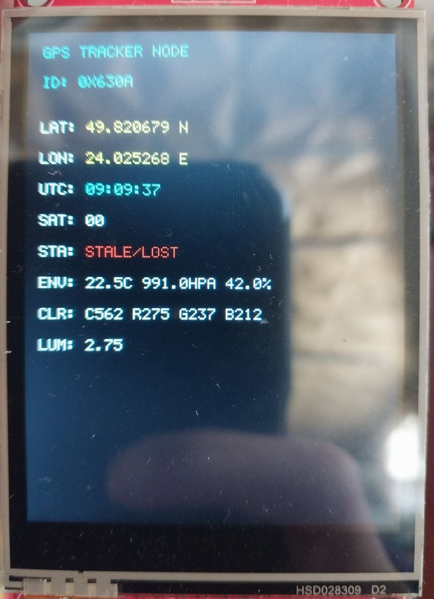
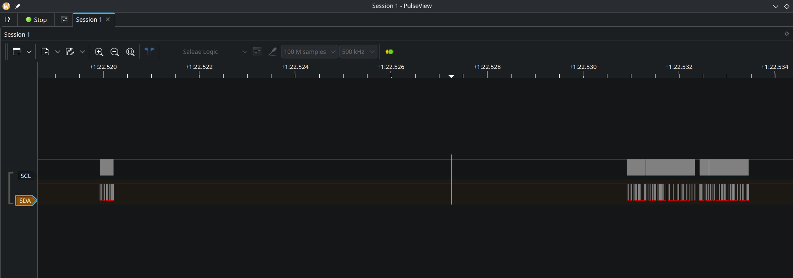
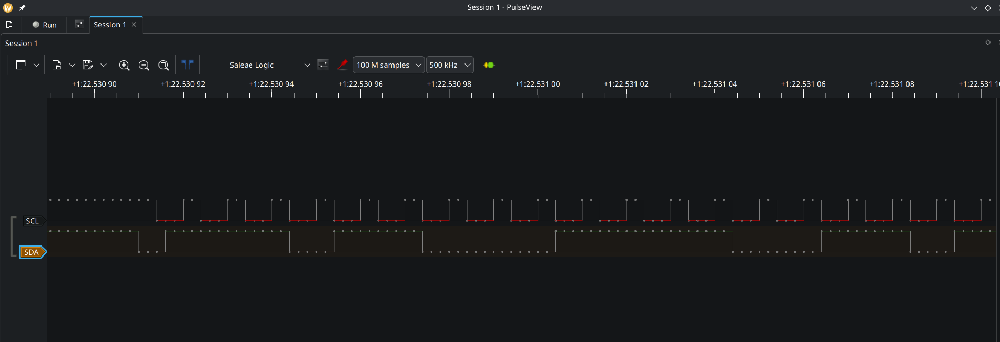
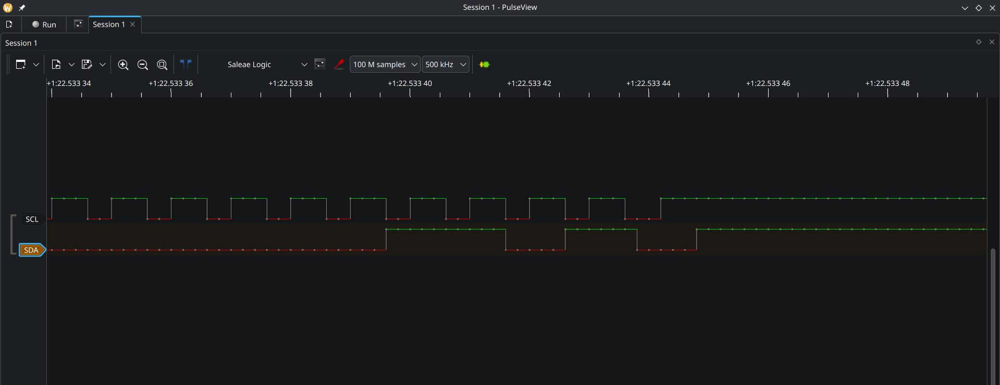

# Lab 3 - I2C sensors on an SPI display

STM32F401 ("Black Pill") firmware that reads a BME280 (temperature / pressure / humidity) and a TCS3472 colour sensor over I2C and shows them on an ILI9341 SPI-TFT next to the live GPS position and time. Every sensor row keeps its last valid value and is marked as stale when fresh data stops arriving.

**Contributors:**
- **Bohdan Zasymovych**
- **Yaryna Zabchuk**


## Project structure

```text
Lab_I2C/
├── Lab_I2C.ioc                 CubeMX project
├── Core/
│   ├── Inc/utils/              headers of this project's own modules
│   │   ├── bme280.h            BME280 driver: forced mode, compensation, stale
│   │   ├── tcs3472.h           TCS3472 driver: init, C/R/G/B read, stale
│   │   ├── ui.h                dirty-row layout (GPS + sensor rows)
│   │   ├── ili9341.h           display driver (SPI + DMA)
│   │   ├── gps_parser.h        NMEA parsing + line queue
│   │   ├── gps_flash.h         last-fix flash cache
│   │   └── cli.h               USB-CDC command line
│   └── Src/                    main.c, interrupt handlers, utils/*.c
└── USB_DEVICE/                 CubeMX USB-CDC (VCP) stack

assets/                         screenshots and photo used in this README
host-setup/                     udev rule for a stable /dev path
```


## Pin map

| Signal | Pin | Notes |
|---|---|---|
| I2C2_SCL | PB10 | open drain, AF4 |
| I2C2_SDA | PB3 | open drain, AF9 |
| SPI1_SCK / MOSI | PA5 / PA7 | display |
| LCD_CS / DC / RESET | PB6 / PB7 / PB8 | GPIO outputs |
| LCD_LED | 3.3V | backlight |
| USART1_TX / RX | PA9 / PA10 | to GPS RX / from GPS TX |
| Status LED | PC13 | toggles every 50 ms in the main loop |
| USB | native OTG FS | CDC ACM (VID `0483`, PID `5740`) |

## Buses and rates

| Bus | Setting |
|---|---|
| I2C2 | 100 kHz, standard mode, 7-bit addressing |
| SPI1 | Mode 0, 8-bit, MSB first, 10.5 MHz SCK (84 MHz / 8), TX by DMA |
| USART1 | 9600 8N1, RX by DMA with IDLE-line detection |

| I2C device | 7-bit address |
|---|---|
| BME280 | `0x76` |
| TCS3472 | `0x29` |

| Activity | Period |
|---|---|
| Sensor read (both) | 1 s |
| Display refresh (changed rows only) | 1 s |
| Stale check | every main-loop pass (~50 ms) |


## Sensors

### BME280

- Init: chip ID must be `0x60`, then the calibration blocks are read, then the sensor is configured. Every step is checked, and a failed init is retried once per second.
- **Forced mode**: oversampling x1 for T/P/RH, IIR filter coefficient 4. The sensor sleeps between readings.
- One reading per second: trigger measurment, wait 10 ms, poll the status register until `measuring` clears, then read 8 bytes from. Values are compensated with the Bosch reference integer routines.

### TCS3472

- Init: power on (`PON`), wait 3 ms, enable the ADC (`PON | AEN`). Retried once per second if it fails.
- One reading per second: command byte (command bit + auto-increment + register `0x14`), then 8 bytes: clear, red, green, blue (16-bit, little-endian). Integration time and gain are left at the sensor defaults.
- `LUM` is **not lux**: it is a unit-less log-scale light level, `log10(clear + 1)`, used instead of a lux sensor for a smoother display in dark and bright light.

### Stale data

Each sensor stores the time of its last successful read. A read that fails changes nothing, so the last valid value stays. Every main-loop pass sets `is_stale` when the data is older than **3 s** (or was never read), and a successful read clears it immediately.


## Display

```text
ID: 0x<UID-derived 16-bit id>
LAT: <±dd.dddddd N/S>
LON: <±ddd.dddddd E/W>
UTC: <hh:mm:ss>
SAT: <count>
STA: WAITING FIX / ACTIVE FIX / STALE/LOST
ENV: 22.5C 991.0hPa 42.0%
CLR: C562 R275 G237 B212
LUM: 2.75
```

- `ui.c` remembers the text and colour of every data row, pads it to a fixed width, and redraws a row only when it changed, so nothing flickers. `UI_Redraw()` repaints everything (boot, orientation change).
- Stale sensor rows turn **red** and get an age marker: ` !12s` means 12 s since the last valid reading (capped at 99), ` !--` means the sensor never delivered a value. A sensor that failed to initialise shows `… INIT FAILED` in red.
- Text is a 5×7 font in 6×8 cells, drawn with one SPI DMA burst per row.
- The "address" is the 96-bit chip unique ID (`0x1FFF7A10`) XOR-folded to 16 bits.




## CLI

USB CDC, one command per line, replies are prefixed `[CLI]`.

| Command | Response |
|---|---|
| `VER` | firmware version, build date/time, UART/USB parameters |
| `GET POS` / `GET TIME` | position (`LAT,LON,FIX,SATS,AGE_MS`) / ISO time with `STALE` |
| `GET BME` (`GET ENV`) | `TEMP, PRESS, HUM, STALE, AGE_MS` |
| `GET COLOR` (`GET TCS`) | `CLEAR, RED, GREEN, BLUE, STALE, AGE_MS` |
| `RAW ON` / `RAW OFF` | raw NMEA relay (`[LOG]`-tagged) |
| `GET ERRORS` | UART error counters, RX bytes, dropped GPS lines |
| `FLASH SAVE` / `FLASH INFO` | last-fix flash cache |
| `TEST COLORS` / `ORIENT` | full-screen colour test / portrait-landscape toggle |
| `DISP INFO` | last tile's SCK, byte count and DMA time |

The sensor commands only set a request flag in the USB interrupt; the main loop builds the reply so it never reads half-updated sensor data.


## Interrupts and priorities

| Interrupt | Priority |
|---|---|
| USART1 (GPS, IDLE line) | 0 (highest) |
| DMA2 Stream2 (GPS UART RX) | 1 |
| DMA2 Stream3 (SPI1 TX) | 2 |

I2C uses polling, so it adds no interrupt that could delay GPS reception. The BME280 read blocks the main loop for about 10 ms once per second.


## Measurements

| Item | Value |
|---|---|
| Tile update, one data row (24 chars × 6×8 px = 144×8 px, 2304 B, SCK 10.5 MHz), measured in the previous lab | ~1.77 ms |
| Polling periods | 1 s (sensors), 1 s (UI), stale check every ~50 ms |

Mean and standard deviation over 60 s (61 samples, one per second, logged with `GET BME` / `GET COLOR`; σ is the sample standard deviation):

| Quantity | Mean | σ |
|---|---|---|
| Temperature, °C | 22.21 | 0.17 |
| Pressure, hPa | 990.64 | 0.74 |
| Humidity, % | 42.25 | 0.97 |
| Clear, counts | 547.7 | 17.4 |


## Additional features

**Additional tasks from the assignment**
- **Stale age and an "old data" colour.** Stale sensor rows turn red and show how old the value is (` !12s`), instead of a plain stale flag. A sensor that never answered shows ` !--`.
- **Log-scale light level instead of lux.** The `LUM:` row shows `log10(clear + 1)`. It is unit-less (not lux), spans about 0 to 4.8 for a 16-bit count, and keeps dark and bright scenes readable on the same scale.

The second sensor is a TCS3472 instead of a BH1750, because no BH1750 was available. Besides the overall brightness (the clear channel) it returns separate red, green and blue counts, so the node sees the colour of the light as well as its level. All four channels are shown on the `CLR:` row and available over the CLI, and the clear channel also drives the `LUM:` row, which shows the light level.

**CLI additions**

| Command | Example reply |
|---|---|
| `GET BME` (alias `GET ENV`) | `[CLI] TEMP:22.51 C, PRESS:991.02 hPa, HUM:42.03 %, STALE:0, AGE_MS:412` |
| `GET COLOR` (alias `GET TCS`) | `[CLI] CLEAR:562, RED:275, GREEN:237, BLUE:212, STALE:0, AGE_MS:380` |

**Robustness**
- A sensor that is missing or fails to initialise is retried every second, and its display row shows `… INIT FAILED` until it answers, so a sensor can be plugged in after boot.


## Logic analyzer captures

Saleae Logic in PulseView, SCL and SDA, one 1-second main-loop pass at 100 kHz I2C.

**Overview of one sensor cycle on the I2C bus.** Left: trigger of the BME280 measurement, then the 10 ms conversion wait, right: the status read and the 8-byte data read:



**START condition.** SDA falls while SCL is high, then the clock pulses of the first byte (address) follow:



**STOP condition.** After the last clock pulse SCL stays high and SDA rises:



## udev rule (Linux host)

The board enumerates as `/dev/ttyACM*`, whose number can change after a replug. A udev rule gives it a fixed name, `/dev/stm32-blackpill`:

```bash
sudo cp ./host-setup/99-stm32-blackpill.rules /etc/udev/rules.d/
sudo udevadm control --reload-rules
sudo udevadm trigger
```
